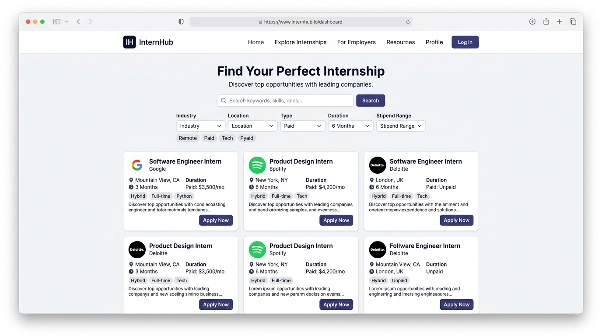
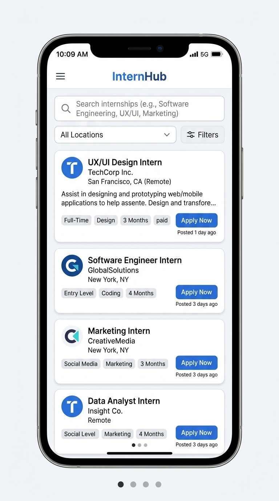
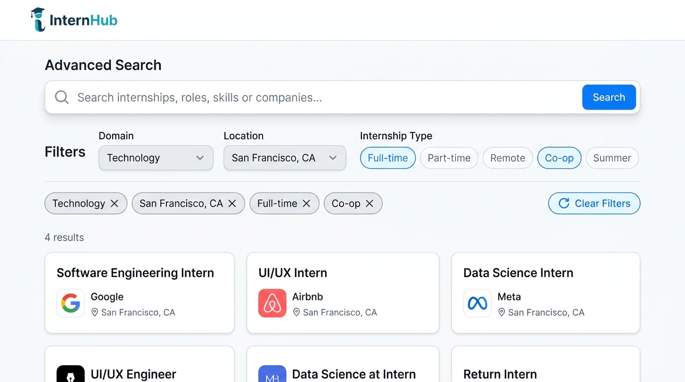

# InternHub – Responsive Internship Board

A modern, accessible, and completely dependency-free internship discovery platform built strictly with **semantic HTML5**, **CSS3**, and **Vanilla JavaScript**. 

Created for the **EdVyro Task 02 Assessment**, this project contains **zero frameworks, zero build tools, and zero npm dependencies**. It runs instantly by opening `index.html` directly in any browser and deploys seamlessly as a static site to **Vercel**, **GitHub Pages**, or **Netlify**.

---

## Table of Contents
- [Project Overview](#project-overview)
- [Zero-Dependency Architecture](#zero-dependency-architecture)
- [Key Features](#key-features)
- [Technologies Used](#technologies-used)
- [Project File Structure](#project-file-structure)
- [How to Run Locally](#how-to-run-locally)
- [Deployment Guide](#deployment-guide)
  - [Deploying to Vercel (Static Site - Zero Build Step)](#deploying-to-vercel-static-site---zero-build-step)
  - [Deploying to GitHub Pages](#deploying-to-github-pages)
  - [Deploying to Netlify](#deploying-to-netlify)
- [Screenshots](#screenshots)
- [Accessibility Compliance (WCAG 2.1 AA)](#accessibility-compliance)
- [Author & Acknowledgments](#author)

---

## Project Overview
**InternHub** is a clean, student-centric internship discovery board designed to help early-career developers and designers explore verified tech internships with complete transparency regarding stipends, durations, locations, and required skillsets.

Unlike modern bloated web applications, InternHub is built from the ground up using **pure web platform standards**. All internship cards, interactive modal dialogs, search queries, and dynamic filters are executed purely with vanilla DOM manipulation—free of any framework overhead.

---

## Zero-Dependency Architecture
This project is engineered to be **100% dependency-free**:
- **No Vite, Webpack, or Bundlers**: No compilation or bundling step required.
- **No React, Vue, or Angular**: Pure DOM manipulation using modern ECMAScript standards.
- **No Tailwind CSS or CSS Preprocessors**: Native CSS3 custom properties, CSS Grid, and Flexbox.
- **No Node.js or npm dependencies**: No `node_modules`, no `package.json` conflicts, and no install scripts.
- **No esbuild or compiler conflicts**: Will never fail on Vercel or CI/CD pipelines due to build errors.

---

## Key Features

- **Responsive Across All Viewports**: Meticulously formatted for small phones (320px, 375px), tablets (768px, 1024px), and desktop displays (1440px+).
- **Instant Search Engine**: Real-time client-side search across internship titles, company names, technology domains, and required skills as you type.
- **Multi-Filter Combination**: Seamlessly combine filters:
  - **Domain Filter**: Web Development, Full Stack, App Development, Python, Data Science, UI/UX, AI/ML, Cloud & DevOps.
  - **Location Filter**: Remote, Bengaluru, Mumbai, Hyderabad, Pune, Delhi NCR.
  - **Internship Type Filter**: Full-time vs. Part-time.
- **Dynamic JavaScript DOM Rendering**: Cards are dynamically instantiated from a structured dataset using `DocumentFragment` for zero layout thrashing.
- **Accessible Details Modal**: HTML5 `<dialog>` component displaying comprehensive internship information, candidate requirements, responsibilities, perks, and a working quick application form.
- **Accessible Keyboard Navigation**: Complete navigation via `Tab`, `Enter`, `Space`, and `Escape`. Focus is trapped in modal dialogs and returned to the trigger button upon dismissal.
- **Live Search & Filter Counter**: Screen-reader friendly live counter updating in real time with active filter chips.
- **Empty State Feedback**: Friendly fallback UI when zero opportunities match the active criteria with an instant "Clear Filters" button.
- **Error State & Recovery**: Try-catch error boundaries displaying user-friendly error UI with a functional "Retry" button.

---

## Technologies Used

- **HTML5**: Semantic tags (`<header>`, `<nav>`, `<main>`, `<section>`, `<article>`, `<dialog>`, `<footer>`).
- **CSS3**: Custom variables, Flexbox, CSS Grid, media queries, and smooth animations.
- **Vanilla JavaScript (ES6+)**: Pure DOM manipulation, array higher-order methods (`filter`, `map`), Event Listeners, and modal lifecycle control.

---

## Project File Structure

```text
internhub-responsive-internship-board/
│
├── index.html            # Semantic HTML5 markup, filter forms & dialog templates
├── style.css             # Native CSS3 styles, variables & responsive breakpoints
├── script.js             # Vanilla JavaScript data, search/filter logic & DOM renderers
├── README.md             # Complete project documentation & deployment guide
└── screenshots/
    ├── desktop.png       # Desktop layout preview (1440px / 16:9)
    ├── tablet.png        # Tablet layout preview (768px - 1024px / 4:3)
    ├── mobile.png        # Mobile layout preview (375px / 9:16)
    └── search-filter.png # Search & filter component preview
```

---

## How to Run Locally

Because this project is a pure static website:

### Method 1: Direct File Opening (No tools needed)
1. Navigate to the project directory:
   ```bash
   cd internhub-responsive-internship-board
   ```
2. Double-click `index.html` or open it with Google Chrome, Firefox, Microsoft Edge, or Safari.

### Method 2: Using Any Lightweight Static Server (Optional)
```bash
# Using Python
python3 -m http.server 8000

# Using Node.js npx serve
npx serve .
```

---

## Deployment Guide

### Deploying to Vercel (Static Site - Zero Build Step)

Since this project contains **no build tools or npm dependencies**, deploying to Vercel is completely error-free:

1. Push your repository to GitHub.
2. Go to [vercel.com](https://vercel.com) and click **"Add New Project"**.
3. Import your repository.
4. **Vercel Settings**:
   - **Framework Preset**: Select `Other` (or None).
   - **Root Directory**: Select `internhub-responsive-internship-board` (or `./`).
   - **Build Command**: Leave **EMPTY / DISABLED** (override and clear any command).
   - **Output Directory**: Leave **EMPTY**.
   - **Install Command**: Leave **EMPTY / DISABLED**.
5. Click **Deploy**. Vercel will deploy the static files directly to its global CDN within seconds!

### Deploying to GitHub Pages
1. Push your code to GitHub:
   ```bash
   git init
   git add .
   git commit -m "feat: complete vanilla JS internship board for EdVyro Task 02"
   git branch -M main
   git remote add origin https://github.com/Shalem-raju18/internhub-responsive-internship-board.git
   git push -u origin main
   ```
2. In your GitHub repository:
   - Go to **Settings** > **Pages**.
   - Under **Build and deployment** > **Source**, choose **Deploy from a branch**.
   - Select branch `main` and folder `/ (root)` or `/internhub-responsive-internship-board`.
   - Click **Save**.

### Deploying to Netlify
1. Log in to [Netlify](https://www.netlify.com).
2. Drag and drop the `internhub-responsive-internship-board` folder directly into the Netlify Drop interface.
3. Your site goes live instantly with SSL enabled.

---

## Screenshots

### 1. Desktop Viewport (1440px)


### 2. Tablet Viewport (768px - 1024px)


### 3. Mobile Viewport (375px)


### 4. Search and Filter Bar


---

## Accessibility Compliance

InternHub strictly implements **WCAG 2.1 AA** guidelines:
1. **Semantic Structure**: Built with native HTML5 structural landmarks (`header`, `nav`, `main`, `section`, `article`, `dialog`, `footer`).
2. **Keyboard Usability**: Full support for `Tab`, `Shift + Tab`, `Enter`, and `Escape` for closing modal dialogs and menus.
3. **Focus Management**: Clear `:focus-visible` outline rings; focus is automatically returned to the triggering button when the modal closes.
4. **Label Associations**: Every input and dropdown has an explicit `<label for="...">` association.
5. **Color Contrast**: All typography adheres to minimum 4.5:1 contrast ratios across canvas, surface, and text colors.

---

## Author

**Shalemraju Janga**  
- **GitHub**: [https://github.com/Shalem-raju18](https://github.com/Shalem-raju18)  
- **LinkedIn**: [https://www.linkedin.com/in/shalemraju-janga/](https://www.linkedin.com/in/shalemraju-janga/)  

*Submitted for the EdVyro Internship Assessment (Task 02).*
